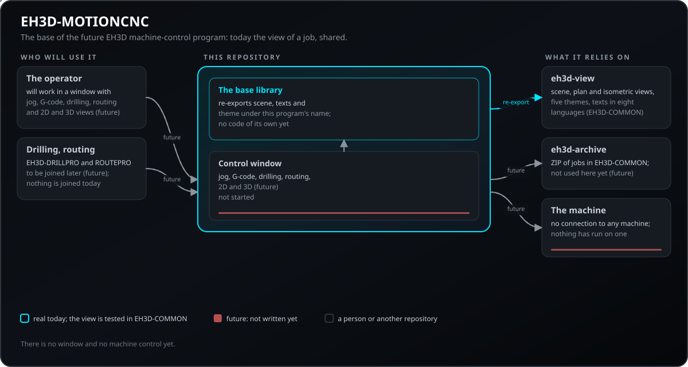
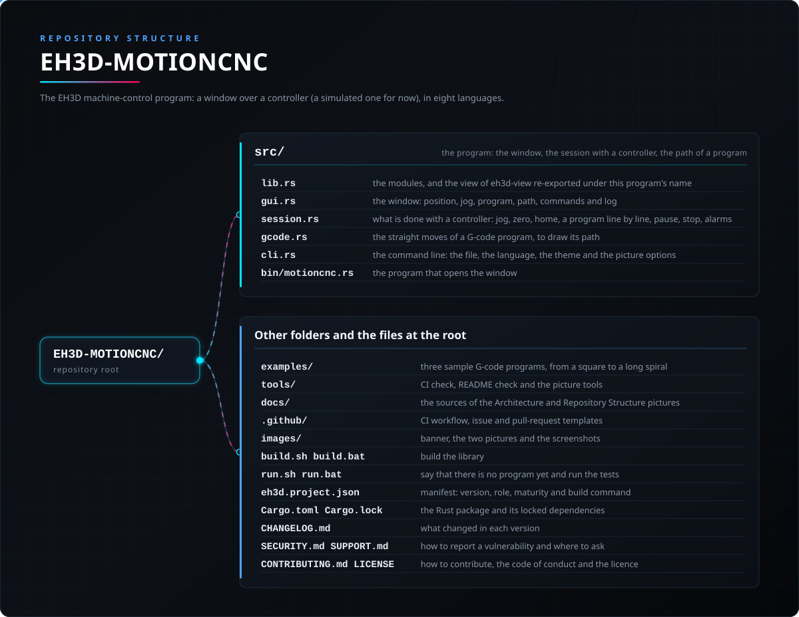

<p align="center">
  
</p>

# 🧭 EH3D-MOTIONCNC

<p align="center">🇺🇸 <b>English</b> | <a href="README_spa.md">🇪🇸 Español</a> | <a href="README_fra.md">🇫🇷 Français</a> | <a href="README_ita.md">🇮🇹 Italiano</a> | <a href="README_deu.md">🇩🇪 Deutsch</a> | <a href="README_zho.md">🇨🇳 中文</a> | <a href="README_jpn.md">🇯🇵 日本語</a> | <a href="README_por.md">🇵🇹 Português</a></p>

### The shared base of the EH3D machine-control programs: the view of a job, the themes and the words of the interface in eight languages

<p align="center">
  
  
  
  
  
  
</p>

---

**Honesty check - what actually runs today:** a Rust crate that uses the view of a job from `eh3d-view` of EH3D-COMMON, where it is shared with the other programs of the suite and has its tests. That view has the scene of a job on the work table (every hole with its drill size, the routing paths, how far the work has got, a drilling job and a routing job on top of each other), the plan view from above and the isometric view of the machine fitted to the table size, a check that says what does not fit on the table before a job starts, five themes (Forge, Neon Arcade, Glass Pro, the classic Windows grey and one that follows the colours of Windows) and the words of the interface in eight languages. **There is no window and no machine control yet**, nothing here has run on a machine and this repository has no tests of its own: it only re-exports the view.

---

> **Safety and security status:** this repository is not a safety system and does not drive any machine. It opens no serial port and no network connection and reads no files of other people. When machine control is added, it will have to prove itself on a simulator and then on a real machine before it is called working, and the limit switches and an emergency stop stay the job of the machine's own control unit.

## 📋 At a glance

| | |
|---|---|
| Version | `0.0.2` |
| Maturity | Scaffolding |
| Tests | 0 |
| Stack | Rust |
| On real hardware | No: nothing here connects to a machine |

**Jump to:** [Overview](#-overview) · [Architecture](#-architecture) · [Quick start](#-quick-start) · [Testing](#-testing) · [Structure](#-repository-structure) · [Related](#-related-projects)

## 🚦 Project status

Each line is one part of this repository and the light says how far it is today. It is written from what the repository can show (tests, builds, runs), not from what is planned.

🟢 Done and verified · 🟡 Works, with known limits · 🟠 Partly done or not verified yet · 🔴 Not done or not working

| Area | State | What it means here |
|---|---|---|
| Base library | 🟡 | A Rust crate that re-exports `scene`, `texts` and `theme` of `eh3d-view` under this program's name; it needs the folder of EH3D-COMMON next to it. |
| Scene and views | 🟡 | Written and tested on a computer in EH3D-COMMON: the job on the table, the plan and isometric views, the check of what does not fit; no window draws them yet. |
| Themes and texts | 🟡 | Five themes with a contrast check and the words of the interface in eight languages, tested in EH3D-COMMON; not seen in a window yet. |
| Tests | 🟠 | This repository has 0 tests of its own (`cargo test`): the view is tested where it lives, in EH3D-COMMON. |
| Window and jog | 🔴 | Not started. |
| Machine control | 🔴 | Not started: no connection to any machine, no G-code, no drilling or routing job runs from here. |
| Documentation | 🟡 | README in eight languages, the two pictures and the changelog; there is little to document until the program exists. |

## 🎯 Overview

* The **base library** (`src/lib.rs`): re-exports `scene`, `texts` and `theme` from `eh3d-view` of EH3D-COMMON, so that the future program uses them under its own name and every program of the suite shows a job the same way.
* The **scene** of a job on the work table: holes by drill size, routing paths, the progress of the work, a drilling and a routing job on top of each other, the plan view from above, the isometric view of the machine fitted to the table size and a check of what does not fit on the table.
* The **themes**: Forge (the default), Neon Arcade, Glass Pro, the classic Windows grey and one that follows the colours of Windows; a user can write their own in a text file.
* The **words of the interface** in English, Spanish, Italian, German, French, Portuguese, Chinese and Japanese.
* What it will be: one program to drill, to route and to do 2D and 3D CNC work, built on this base, on the ZIP of jobs of EH3D-COMMON (`eh3d-archive`) and on the engines of EH3D-DRILLPRO and EH3D-ROUTEPRO. **None of that exists yet.**

## 🧩 Role in EH3D

EH3D-MOTIONCNC is the future machine-control program of EH3D and, today, only its base. It depends by path on EH3D-COMMON (the folder `EH3D-COMMON` must sit next to this one) and does not depend on any other EH3D repository yet.

## 🏛️ Architecture

<p align="center">
  
</p>

How the parts fit together: who will use it, what this repository holds and what it relies on. The picture is drawn from `docs/architecture.json`, is checked against the code and marks what is future as future.

## 🔒 Security & Safety

This repository opens no serial port, no network connection and no file of other people; the only outside text its parts read is a theme file written by the user, which is checked rather than trusted. It does not drive a machine and is not a safety system. See [SECURITY.md](SECURITY.md).

## 🚀 Quick start

You need a stable Rust toolchain and the folder `EH3D-COMMON` next to this one.

```bash
cargo build --release
cargo test
cargo clippy --all-targets -- -D warnings
cargo fmt --all --check
python -I tools/ci_validate.py
```

`build.bat` / `build.sh` build the library, `test.bat` / `test.sh` run the tests and `run.bat` / `run.sh` say that there is no program yet and run the tests. The scripts wait for a key at the end unless `NOPAUSE` is set.

## 🧪 Testing

`cargo test` reports 0 tests here: this repository only re-exports the view, whose tests are in EH3D-COMMON. The CI also runs `cargo fmt --check` and `cargo clippy` with warnings as errors, and `python -I tools/ci_validate.py` checks the manifest, the versions, the changelog and the eight READMEs.

## 🏗️ Build & Release

The version lives in `Cargo.toml` and in `eh3d.project.json`, and each version has its entry in [CHANGELOG.md](CHANGELOG.md). There is no program to package yet, so there are no ready-made binaries.

## 📂 Repository Structure

<p align="center">
  
</p>

<details>
<summary>Text version of the tree</summary>

```text
EH3D-MOTIONCNC/
├── src/
│   └── lib.rs                                   re-exports scene, texts and theme from eh3d-view of EH3D-COMMON
├── tools/                                       CI check, README check and the picture tools
├── docs/                                        the sources of the Architecture and Repository Structure pictures
├── .github/                                     CI workflow, issue and pull-request templates
├── images/                                      banner and the Architecture and Repository Structure pictures
├── build.sh build.bat                           build the library
├── run.sh run.bat                               say that there is no program yet and run the tests
├── eh3d.project.json                            manifest: version, role, maturity and build command
├── Cargo.toml Cargo.lock                        the Rust package and its locked dependencies
├── CHANGELOG.md                                 what changed in each version
├── SECURITY.md SUPPORT.md                       how to report a vulnerability and where to ask
└── CONTRIBUTING.md CODE_OF_CONDUCT.md LICENSE   how to contribute, the code of conduct and the licence
```

</details>

## 🗺️ Roadmap & Known limits

**Known limits today**

* There is no window and no machine control: nothing here has run on a machine.
* There are no tests in this repository; the view is tested in EH3D-COMMON.
* It needs the folder `EH3D-COMMON` next to it, because it depends on it by path.

**Next**

* Study the machine-control programs that exist today (a native one and a .NET one) to decide what the operator needs.
* A window with the scene, the themes and the words of the interface.
* Jog and G-code: connection to a machine, first on a simulator.
* 2D and 3D views of a running job.
* Join the engines of EH3D-DRILLPRO and EH3D-ROUTEPRO so that one program drills and routes.

## 🌍 Languages

README and texts exist in English, Spanish, French, Italian, German, Chinese, Japanese and European Portuguese.

## 🔗 Related Projects

* [EH3D-COMMON](https://github.com/JuanenRac/EH3D-COMMON): where the view (`eh3d-view`) and the ZIP of jobs (`eh3d-archive`) live
* [EH3D-DRILLPRO](https://github.com/JuanenRac/EH3D-DRILLPRO): the drilling program whose engine will be joined here
* [EH3D-ROUTEPRO](https://github.com/JuanenRac/EH3D-ROUTEPRO): the routing program whose engine will be joined here

## 📚 Documentation

* [Changelog](CHANGELOG.md)
* [Security policy](SECURITY.md) and [support](SUPPORT.md)
* The view of a job is documented in EH3D-COMMON, where it lives.

## 🤝 Contributing & Community

* Before a pull request run `cargo fmt --all --check`, `cargo clippy --all-targets -- -D warnings`, `cargo test` and `python -I tools/ci_validate.py`: all must pass. See [CONTRIBUTING.md](CONTRIBUTING.md) and the [code of conduct](CODE_OF_CONDUCT.md).
* The README exists in eight languages: a change to the text is made in all eight files, and the two pictures are drawn from `docs/architecture.json` and `docs/structure.json` by `tools/make_architecture.py` and `tools/make_structure.py`.
* Do not describe as working what has not been run on a machine.
* Report a vulnerability privately: [SECURITY.md](SECURITY.md). Questions, ideas and reports: electrohobby3d@gmail.com ([SUPPORT.md](SUPPORT.md)).

## 👤 AUTHOR

**JuanenRac (Electro Hobby 3D)** · electrohobby3d@gmail.com

## 📜 LICENSE

Software: GPL-3.0-or-later. See [LICENSE](LICENSE). Hardware designs of the suite use CERN OHL-S.
