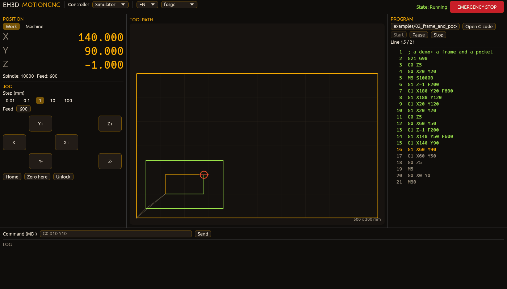
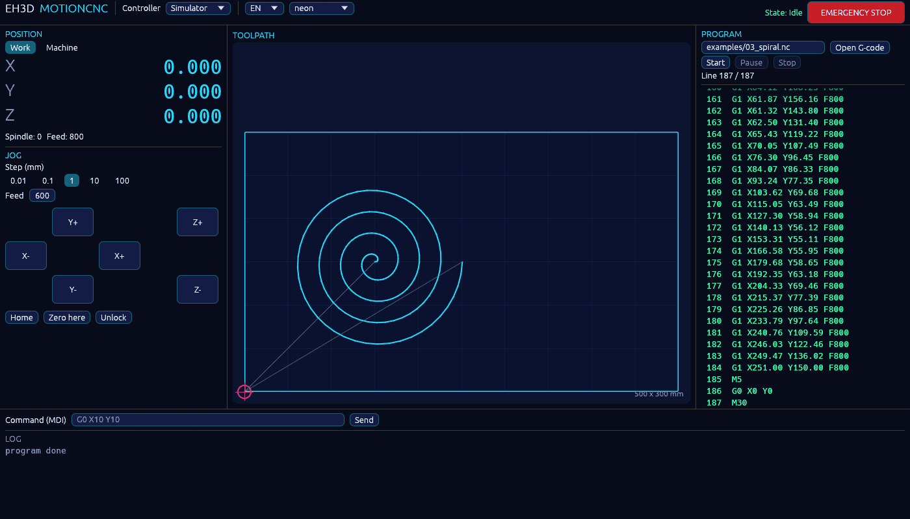
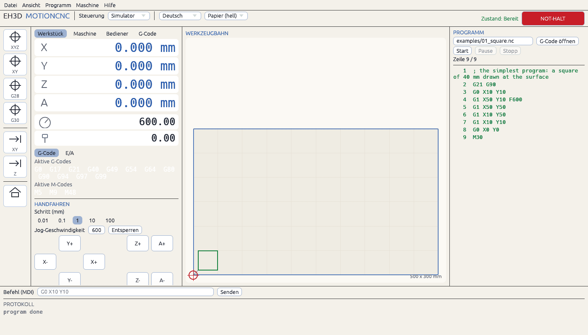
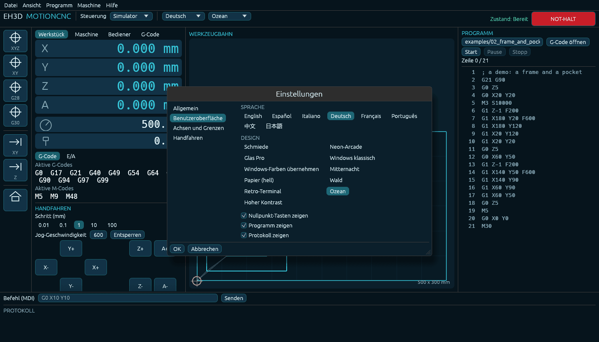
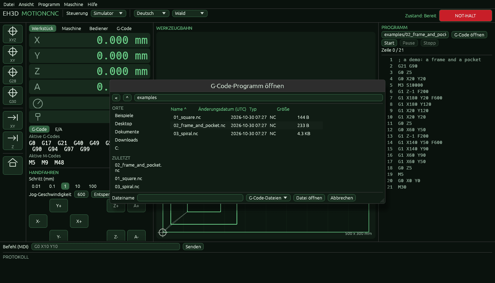

<p align="center">
  
</p>

# 🧭 EH3D-MOTIONCNC

<p align="center"><a href="README.md">🇺🇸 English</a> | <a href="README_spa.md">🇪🇸 Español</a> | 🇫🇷 <b>Français</b> | <a href="README_ita.md">🇮🇹 Italiano</a> | <a href="README_deu.md">🇩🇪 Deutsch</a> | <a href="README_zho.md">🇨🇳 中文</a> | <a href="README_jpn.md">🇯🇵 日本語</a> | <a href="README_por.md">🇵🇹 Português</a></p>

### La base commune des programmes de commande de machine EH3D : la vue d'un travail, les thèmes et les textes de l'interface en huit langues

<p align="center">
  
  
  
  
  
  
</p>

---

**Vérification d'honnêteté - ce qui tourne aujourd'hui :** un programme Rust avec une fenêtre (`motioncnc`) qui pilote une machine **simulée** : il montre la position de la machine (pièce et machine), la déplace à la main avec un pavé de jog, fixe le zéro, fait la prise d'origine, prend les commandes tapées par l'opérateur, exécute un programme G-code ligne par ligne (avec pause, arrêt et arrêt d'urgence), dessine la trajectoire du programme sur la table avec les lignes faites marquées, et s'arrête sur ce que le contrôleur refuse. La fenêtre parle 37 langues et porte onze thèmes. L'interface des contrôleurs (`eh3d-controller`, dans EH3D-COMMON) a GRBL écrit contre une ligne simulée et liste les autres familles comme pas encore pilotées. 38 tests tournent sur un ordinateur. **Rien ici n'a tourné sur une vraie machine**, un port série n'est ouvert que pour GRBL et une connexion réseau que pour envoyer un programme au serveur, et les arcs et les autres codes ne sont ni dessinés ni exécutés par le simulateur.

---

> **État de sécurité :** ce programme ne pilote qu'une machine simulée : il n'ouvre aucun port série ni connexion réseau. Quand un vrai contrôleur sera connecté, il devra faire ses preuves sur un simulateur puis sur une vraie machine avant d'être dit fonctionnel, et les fins de course et un arrêt d'urgence restent l'affaire de l'unité de commande de la machine ; l'arrêt d'urgence de la fenêtre n'est pas un circuit de sécurité.

## 📋 En un coup d'œil

| | |
|---|---|
| Version | `0.0.6` |
| Maturité | Échafaudage |
| Tests | 38 |
| Pile technique | Rust |
| Sur du matériel réel | Non : il ne pilote qu'une machine simulée |

**Aller à :** [Présentation](#-présentation) · [Architecture](#-architecture) · [Démarrage rapide](#-démarrage-rapide) · [Tests](#-tests) · [Structure](#-structure-du-dépôt) · [Liés](#-projets-liés)

## 🚦 État du projet

Chaque ligne est une partie de ce dépôt et le feu dit où elle en est aujourd'hui. Il est écrit d'après ce que le dépôt peut montrer (tests, compilations, exécutions), pas d'après ce qui est prévu.

🟢 Fait et vérifié · 🟡 Fonctionne, avec des limites connues · 🟠 À moitié fait ou pas encore vérifié · 🔴 Pas fait ou ne fonctionne pas

| Domaine | État | Ce que cela signifie ici |
|---|---|---|
| Bibliothèque de base | 🟡 | Un crate Rust qui réexporte `scene`, `texts` et `theme` d'`eh3d-view` sous le nom de ce programme ; il a besoin du dossier d'EH3D-COMMON à côté. |
| Scène et vues | 🟡 | Écrite et testée dans EH3D-COMMON ; la fenêtre de ce programme dessine la trajectoire d'un programme sur la table et la position de l'outil (vue sur un ordinateur). |
| Thèmes et textes | 🟡 | Onze thèmes et les mots de l'interface en 37 langues, vus dans la fenêtre de ce programme. |
| Tests | 🟡 | 38 tests réussissent sur un ordinateur (`cargo test --features gui`) : la session (jog, zéro, prise d'origine, un programme, pause, alarme, arrêt d'urgence), la trajectoire d'un programme et la ligne de commande ; le contrôleur simulé est testé dans EH3D-COMMON. |
| Fenêtre et jog | 🟡 | Fonctionne sur un ordinateur avec le contrôleur simulé : position, pavé de jog, pas, avance, prise d'origine, zéro, déverrouillage, une ligne de commandes et un journal ; pas de vraie machine. |
| Commande de machine | 🟠 | Seulement le simulateur : un programme s'exécute ligne par ligne avec pause, arrêt et arrêt d'urgence ; aucun vrai contrôleur n'est encore connecté d'ici. |
| Documentation | 🟡 | README en huit langues, les deux images, trois programmes d'exemple et le changelog. |

## 🎯 Présentation

* La **fenêtre** (`src/gui.rs`, `motioncnc`) : la position de la machine (pièce et machine), un pavé de jog avec ses pas et son avance, prise d'origine, zéro et déverrouillage, l'arrêt d'urgence, une ligne de commandes avec son journal, et le programme avec sa trajectoire sur la table.
* La **session** (`src/session.rs`) : ce que le programme fait avec n'importe quel contrôleur de `eh3d-controller` : jog, zéro, prise d'origine, envoyer une ligne, exécuter un programme ligne par ligne, pause, arrêt et les alarmes ; elle est testée sur le contrôleur simulé.
* La **trajectoire d'un programme** (`src/gcode.rs`) : les déplacements droits (`G0`, `G1`, absolus ou relatifs, en mm ou en pouces) dessinés avant l'exécution ; les arcs ne sont pas dessinés.
* Le **contrôleur simulé** (`eh3d_controller::sim`, dans EH3D-COMMON) : une machine en mémoire avec des limites de course qui déclenchent une alarme ; les familles de contrôleurs du marché sont listées dans `eh3d-controller`, GRBL est la première écrite et les autres apparaissent comme pas encore pilotées.
* Les **thèmes et les mots** de `eh3d-view` : Forge (par défaut), Neon Arcade, Glass Pro, le gris classique de Windows et un qui suit Windows, et l'interface en anglais, espagnol, italien, allemand, français, portugais, chinois et japonais. Ce qu'il sera : un programme pour percer, fraiser et faire de la CNC 2D et 3D sur les moteurs d'EH3D-DRILLPRO et EH3D-ROUTEPRO ; cette partie n'existe pas encore.
* Les **menus, les réglages et les fichiers** : les menus Fichier, Affichage, Programme, Machine et Aide avec ce que PlanetCNC y met (ouvrir, récents, enregistrer, modifier, les zéros, les positions mémorisées, la broche et l'arrosage) ; une fenêtre de réglages (unités, langue, onze thèmes, limites de course, jog) mémorisée entre les exécutions ; et les fenêtres Ouvrir et Enregistrer de la suite (`eh3d-filedialog` : lieux, tri, filtres, l'extension d'un fichier enregistré et la question avant de remplacer).
* **GRBL sur un port série :** compilé avec `--features serial`, `motioncnc --grbl PORT[@BAUD]` pilote un contrôleur GRBL (115200 bauds par défaut) à la place du simulateur et `motioncnc --ports` liste les ports série ; une version sans la fonctionnalité, ou un port qui ne s'ouvre pas, le dit et quitte. Essayé seulement contre un contrôleur scénarisé, jamais contre un vrai.
* **Une fenêtre qui suit l'écran :** elle s'ouvre agrandie et, de 720p à 1080p et jusqu'aux écrans plus grands et plus larges, tout grandit ou rétrécit avec elle.
* **Reprendre après une panne :** pendant qu'un programme tourne, la ligne atteinte est enregistrée dans un petit fichier ; si la fenêtre, l'ordinateur ou la liaison tombe, le démarrage suivant demande s'il faut reprendre à cette ligne ou abandonner. Rien n'est envoyé au contrôleur tant que l'opérateur n'a pas répondu.
* **Envoyé au serveur EH3D :** avec l'adresse du serveur, le jeton de ce programme et l'identifiant de la machine dans les réglages (section Serveur de la fenêtre des réglages, ou `server_address`, `server_token` et `server_machine` dans le fichier de réglages), **Programme > Envoyer au serveur** envoie le texte du programme comme un travail G-code ; le serveur l'exécute sur sa machine (un contrôleur GRBL sur son port série, ou son simulateur) et la fenêtre le suit : l'état, le pourcentage et la ligne atteinte dans la barre du haut, le panneau et le journal. Démarrer, Pause et Arrêter de la fenêtre atteignent le travail sur le serveur, fermer la fenêtre ne l'arrête pas, et un travail arrêté est repris à la ligne atteinte par le serveur (le démarrage suivant de la fenêtre le propose, comme pour un programme du contrôleur) : le serveur rend les codes en vigueur et attend l'opérateur avant le premier mouvement. La broche et l'arrosage ne sont relancés qu'avec `server_restore_outputs = yes`. Essayé avec un faux serveur ; les tests du serveur lui-même envoient les mêmes requêtes à son simulateur. Jamais sur une machine.

## 🧩 Rôle dans EH3D

EH3D-MOTIONCNC est le programme de commande de machine d'EH3D, qui fonctionne aujourd'hui sur une machine simulée. Il dépend par chemin d'EH3D-COMMON (le dossier `EH3D-COMMON` doit se trouver à côté de celui-ci : la vue, les thèmes, les mots et les contrôleurs) et d'aucun autre dépôt EH3D pour l'instant.

## 🏛️ Architecture

<p align="center">
  
</p>

Comment les parties s'assemblent : qui l'utilisera, ce que contient ce dépôt et sur quoi il s'appuie. L'image est dessinée à partir de `docs/architecture.json`, vérifiée par rapport au code, et marque comme futur ce qui est futur.

## 🖼️ Captures d'écran

<p align="center">
  
</p>

<p align="center"><em>Un programme en cours sur la machine simulée : les lignes faites en vert, la ligne en cours en clair, la trajectoire dessinée sur la table et l'outil là où est la machine.</em></p>

<p align="center">
  
</p>

<p align="center"><em>Le thème Minuit, avec un long programme terminé.</em></p>

<p align="center">
  
</p>

<p align="center"><em>L'interface en allemand avec le thème clair Papier : chaque mot de la fenêtre suit la langue.</em></p>

<p align="center">
  
</p>

<p align="center"><em>La fenêtre des réglages, avec les sections à gauche comme l'arbre de PlanetCNC : la langue, les onze thèmes et ce qui est affiché.</em></p>

<p align="center">
  
</p>

<p align="center"><em>La fenêtre Ouvrir de la suite : lieux, récents, la liste du dossier avec ses dates et tailles, le nom et le type.</em></p>

## 🔒 Sécurité et protection

Ce programme n'ouvre un port série que s'il est lancé pour GRBL (`--grbl`, une compilation avec `--features serial`) et une connexion réseau que vers le serveur EH3D dont l'adresse est dans les réglages, quand l'opérateur lui envoie un programme ; le jeton est gardé comme texte dans le fichier de réglages. Il n'ouvre aucun fichier d'autres personnes, sauf le fichier G-code que choisit l'opérateur (lu comme du texte, jamais exécuté de lui-même), et n'est pas un système de sécurité. Voir [SECURITY.md](SECURITY.md).

## 🚀 Démarrage rapide

Il faut une chaîne d'outils Rust stable et le dossier `EH3D-COMMON` à côté de celui-ci.

```bash
cargo build --release --features gui
cargo test --features gui
cargo clippy --all-targets --features gui -- -D warnings
cargo fmt --all --check
python -I tools/ci_validate.py
cargo run --release --features gui -- examples/02_frame_and_pocket.nc
```

`build.bat` / `build.sh` compilent le programme, `test.bat` / `test.sh` lancent les tests et `run.bat` / `run.sh` ouvrent la fenêtre sur un programme d'exemple. Les scripts attendent une touche à la fin sauf si `NOPAUSE` est défini.

## 🧪 Tests

`cargo test --features gui` lance 38 tests : la session (jog et zéro, un programme ligne par ligne, pause et reprise, une ligne refusée, l'arrêt d'urgence et l'alarme, le journal des commandes, la prise d'origine), la trajectoire d'un programme et la ligne de commande ; la vue et le contrôleur simulé sont testés dans EH3D-COMMON. La CI lance aussi `cargo fmt --check` et `cargo clippy` avec les avertissements en erreurs, et `python -I tools/ci_validate.py` vérifie le manifeste, les versions, le changelog et les huit README.

## 🏗️ Compilation et publication

La version se trouve dans `Cargo.toml` et dans `eh3d.project.json`, et chaque version a son entrée dans [CHANGELOG.md](CHANGELOG.md). Il n'y a pas encore de programme à empaqueter, donc pas de binaires prêts à l'emploi.

## 📂 Structure du dépôt

<p align="center">
  
</p>

<details>
<summary>Version texte de l'arborescence</summary>

```text
EH3D-MOTIONCNC/
├── src/
│   ├── lib.rs                                   les modules et la vue d'eh3d-view réexportée sous le nom de ce programme
│   ├── gui.rs                                   la fenêtre : position, jog, programme, trajectoire, commandes et journal
│   ├── session.rs                               ce qu'on fait avec un contrôleur : jog, zéro, prise d'origine, un programme ligne par ligne, pause, arrêt, alarmes
│   ├── gcode.rs                                 les déplacements droits d'un programme G-code, pour dessiner sa trajectoire
│   ├── cli.rs                                   la ligne de commande : le fichier, la langue, le thème et les options d'image
│   ├── bin/motioncnc.rs                         le programme qui ouvre la fenêtre
│   ├── server.rs                                la liaison au serveur EH3D : envoyer, suivre, mettre en pause, arrêter
│   ├── settings.rs                              ce qui est mémorisé entre exécutions
│   ├── gui/dialogs.rs                           menus, réglages, Ouvrir, Enregistrer
│   └── gui/remote.rs                            le programme sur le serveur : Démarrer, Pause, Arrêter et reprendre
├── examples/                                    trois programmes G-code d'exemple, d'un carré à une longue spirale
├── tools/                                       contrôle de CI, du README et outils d'images
├── docs/                                        les sources des images d'Architecture et de Structure du dépôt
├── .github/                                     workflow de CI, modèles d'issues et de pull requests
├── images/                                      bannière, les deux images et les captures d'écran
├── build.sh build.bat                           compilent la bibliothèque
├── run.sh run.bat                               indiquent qu'il n'y a pas encore de programme et lancent les tests
├── eh3d.project.json                            manifeste : version, rôle, maturité et commande de compilation
├── Cargo.toml Cargo.lock                        le paquet Rust et ses dépendances figées
├── CHANGELOG.md                                 ce qui a changé dans chaque version
├── SECURITY.md SUPPORT.md                       signaler une vulnérabilité et poser des questions
└── CONTRIBUTING.md CODE_OF_CONDUCT.md LICENSE   contribuer, code de conduite et licence
```

</details>

## 🗺️ Feuille de route et limites connues

**Limites connues aujourd'hui**

* Rien ici n'a tourné sur une vraie machine : le contrôleur est un simulateur (ou GRBL sur un port série, jamais essayé) et le serveur n'est atteint que par les tests.
* Le simulateur ne prend que le G-code de base (`G0`, `G1`, `G90`, `G91`, `G20`, `G21`, `G92`, `M3` à `M9`) ; les arcs, les cycles fixes et le palpage sont refusés, et la trajectoire ne dessine pas les arcs.
* Il a besoin du dossier `EH3D-COMMON` à côté, car il en dépend par chemin.

**Ensuite**

* Un vrai contrôleur : d'abord GRBL par un port série, puis les autres familles, puis le contrôleur de HYDRA-UMC.
* Les arcs et le reste du G-code dans le simulateur et dans la trajectoire.
* Une vue 3D de la trajectoire avec la hauteur des coupes.
* Palpage, changeur d'outils et les matériaux de la machine.
* Réunir les moteurs d'EH3D-DRILLPRO et EH3D-ROUTEPRO pour qu'un seul programme perce et fraise.

## 🌍 Langues

Le README et les textes existent en anglais, espagnol, français, italien, allemand, chinois, japonais et portugais européen.

## 🔗 Projets liés

* [EH3D-COMMON](https://github.com/JuanenRac/EH3D-COMMON) : là où vivent la vue (`eh3d-view`) et le ZIP des travaux (`eh3d-archive`)
* [EH3D-DRILLPRO](https://github.com/JuanenRac/EH3D-DRILLPRO) : le programme de perçage dont le moteur sera réuni ici
* [EH3D-ROUTEPRO](https://github.com/JuanenRac/EH3D-ROUTEPRO) : le programme de fraisage dont le moteur sera réuni ici

## 📚 Documentation

* [Journal des modifications](CHANGELOG.md)
* [Politique de sécurité](SECURITY.md) et [assistance](SUPPORT.md)
* La vue d'un travail est documentée dans EH3D-COMMON, là où elle vit.

## 🤝 Contribuer et communauté

* Avant une pull request, lancez `cargo fmt --all --check`, `cargo clippy --all-targets -- -D warnings`, `cargo test` et `python -I tools/ci_validate.py` : tout doit passer. Voir [CONTRIBUTING.md](CONTRIBUTING.md) et le [code de conduite](CODE_OF_CONDUCT.md).
* Le README existe en huit langues : une modification du texte se fait dans les huit fichiers, et les deux images sont dessinées à partir de `docs/architecture.json` et `docs/structure.json` par `tools/make_architecture.py` et `tools/make_structure.py`.
* Ne décrivez pas comme fonctionnel ce qui n'a pas tourné sur une machine.
* Signalez une vulnérabilité en privé : [SECURITY.md](SECURITY.md). Questions, idées et rapports : electrohobby3d@gmail.com ([SUPPORT.md](SUPPORT.md)).

## 👤 AUTEUR

**JuanenRac (Electro Hobby 3D)** · electrohobby3d@gmail.com

## 📜 LICENCE

Logiciel : GPL-3.0-or-later. Voir [LICENSE](LICENSE). Les conceptions matérielles de la suite utilisent CERN OHL-S.
